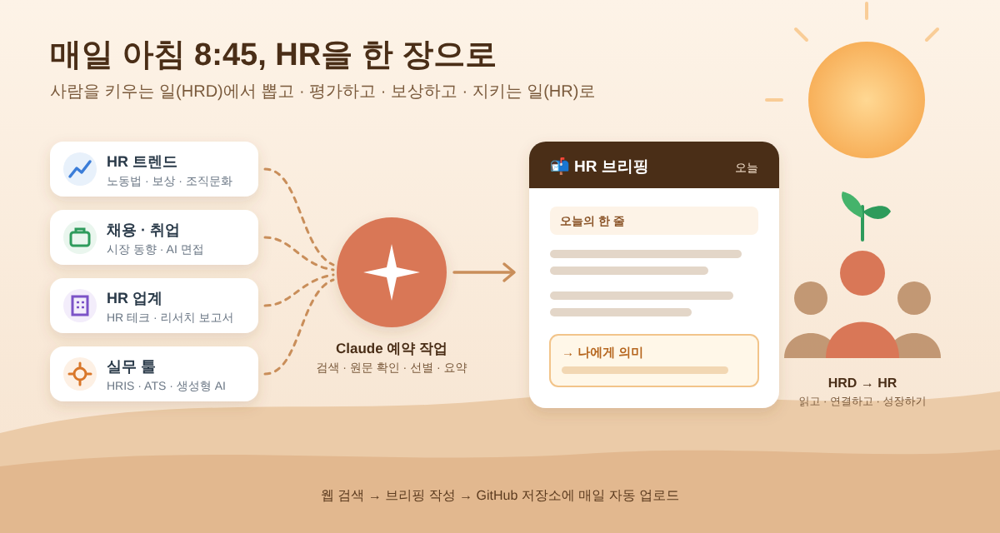

# AX 사례 보고서: HR 데일리 브리핑 자동화

1. 개요 및 목적

* 분석 도구/기술: Claude 예약 작업(Scheduled Task)이 매일 08:45(한국 시간)에 클라우드에서 자동 실행되어, 웹 검색(WebSearch)과 원문 확인(WebFetch)으로 HR 소식을 모으고 요약한 뒤, Git으로 GitHub 저장소(`briefings/`)에 Markdown 브리핑을 올리는 자동화입니다.
* 도입 배경 (Pain Point): 기업교육(HRD) 담당자로서 노무·채용·평가보상·HR 테크 소식은 놓치기 쉬웠고, 국내외 소스를 매일 직접 찾아 읽으려면 하루 1시간 넘게 걸려 자주 건너뛰었습니다. 읽어도 내 업무와 연결해 정리하지 못해 남지 않았고, 법 개정 기사는 "발표"와 "시행"을 헷갈리기 쉬웠습니다.

2. 기술 분석

* 핵심 기능 및 장점: 사람이 없어도 매일 정해진 시간에 실행되고 끝나면 휴대폰으로 알려 줍니다. 네 영역(HR 트렌드, 채용·취업, HR 업계, 실무 툴)을 국내·해외로 나눠 검색한 뒤 5~8개만 골라, 소식마다 "→ 나에게 의미" 한 줄을 붙입니다. 이전 브리핑을 읽고 중복을 피하며, 법 개정은 시행일·적용 대상·국회 통과 여부를 반드시 표시합니다. 날짜별 기록이 Git에 쌓이고, 설정은 코드가 아닌 한국어 지시문만 고치면 바뀝니다.
* 한계점 (보안, 비용 등): 공개 저장소라 사내 자료나 직원 정보를 넣으면 그대로 외부에 노출되므로 공개 뉴스만 다뤄야 합니다. 검토 없이 main 브랜치에 바로 올라가기 때문에 AI의 요약 오류가 그대로 게시될 수 있어, 법·제도 내용은 고용노동부 원문으로 다시 확인해야 합니다. 유료 기사나 일부 사이트는 열리지 않아 2차 보도에 의존할 때가 있습니다. 별도 서버 비용은 없지만 Claude 요금제 사용량을 매일 쓰므로 한도에 따라 실행이 제한될 수 있습니다.

3. 업무 적용 (AX Workflow)

* 적용 대상: HR 전반으로 시야를 넓히고 HR 직무 커리어를 준비하는 HRD 담당자 본인의 매일 HR 동향 파악 업무 (이후 인사팀·교육팀 주간 이슈 공유로 확장 가능)
* Before & After:
   * Before: 출근 후 포털·언론사·고용노동부 사이트를 돌며 영역마다 따로 검색하고(약 30분), 기사를 읽고(약 30분), 정리는 자주 생략했습니다(약 20분). 영어로 된 해외 소식은 건너뛰기 일쑤였고, 바쁜 날은 아예 못 해 결국 HRD 소식 위주로만 보게 됐습니다.
   * After: 08:45에 Claude가 검색·원문 확인·선별·요약을 마치고 GitHub에 올린 뒤 알림을 보냅니다. 나는 출근길 10~15분 동안 브리핑을 읽고, "→ 나에게 의미" 중 하나를 골라 내 생각을 더합니다.

4. 기대효과 및 실행 과제

* 기대효과 (시간/비용 절감): 하루 약 60~80분 걸리던 수집·정리가 10~15분 읽기로 줄어, 영업일 20일 기준 한 달 약 15~20시간을 아낄 것으로 추정합니다. 추가 뉴스 구독이나 서버 없이 기존 Claude 요금제 안에서 운영하며, 날짜별 브리핑과 "나에게 의미" 기록이 쌓여 HR 직무 면접에서 최근 이슈를 근거 있게 말할 수 있는 커리어 자산이 됩니다.
